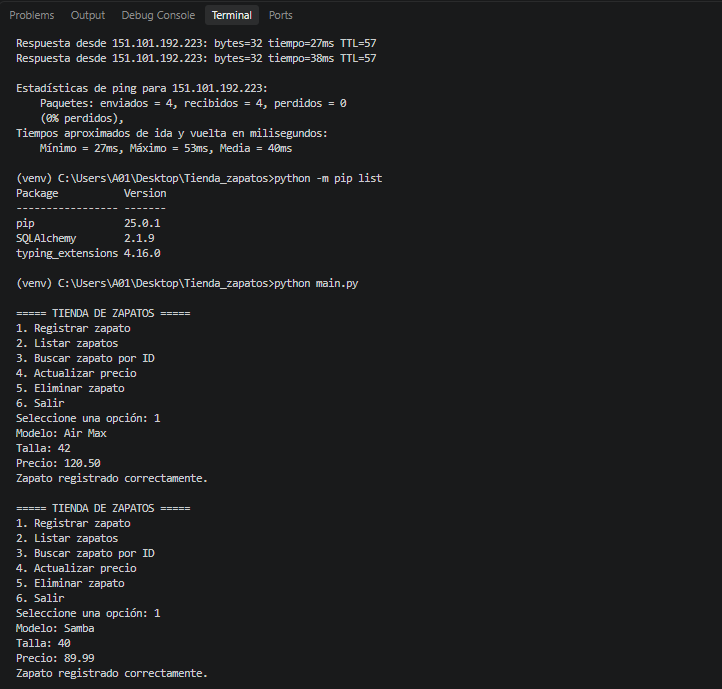
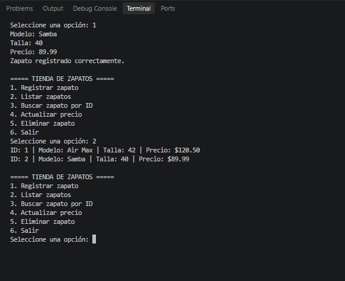
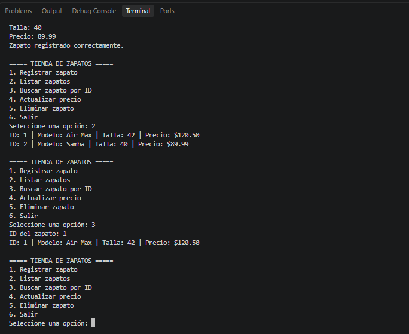
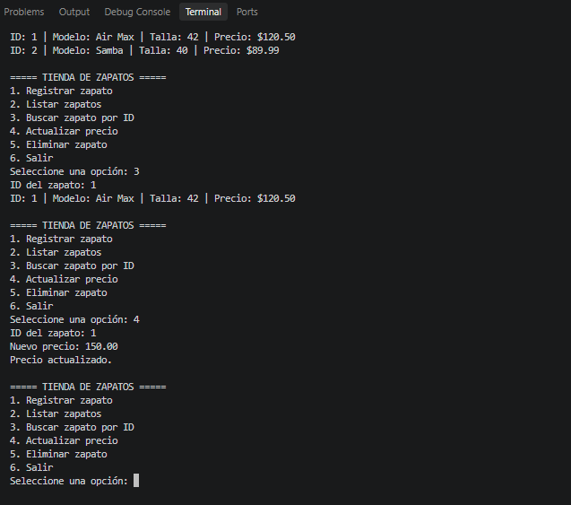
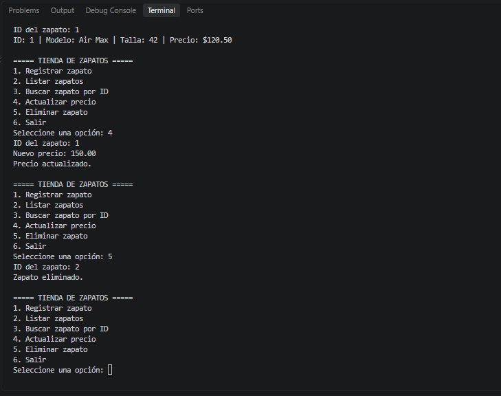
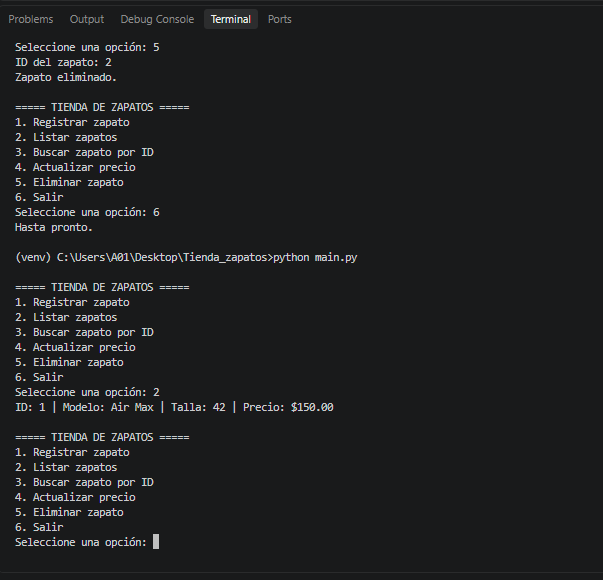

# Sistema de Inventario de Zapatos — SQLAlchemy ORM

## 1. Información del proyecto

| Información | Descripción |
|---|---|
| Estudiante | Andrés [APELLIDOS] |
| Asignatura | [Nombre de la asignatura] |
| Docente | [Nombre del docente] |
| Fecha | 17 de noviembre de 2026 |
| Lenguaje de programación | Python |
| ORM utilizado | SQLAlchemy 2.0 |
| Base de datos | SQLite |

## 2. Descripción del proyecto

**¿En qué consiste el programa?**

Es una aplicación de consola que administra el inventario de una pequeña tienda de zapatos. Para cada zapato guarda su modelo, su talla y su precio. Antes los datos no se guardaban en ningún lado; ahora, gracias a SQLAlchemy y SQLite, quedan almacenados de forma permanente en el archivo `zapateria.db`, y siguen ahí aunque se cierre el programa.

**¿Qué funcionalidades tiene?**

- Registrar zapatos.
- Consultar el inventario completo.
- Buscar un zapato por su ID.
- Actualizar el precio de un zapato.
- Eliminar un zapato.

## 3. Estructura del proyecto

```text
tienda_zapatos/
├── main.py
├── datos.py
├── requirements.txt
├── README.md
└── evidencias/
```

**Explicación de los archivos:**

| Archivo | ¿Cuál es su responsabilidad? |
|---|---|
| `main.py` | Muestra el menú, pide los datos al usuario, valida que sean correctos y llama a las funciones de `datos.py`. No sabe nada de SQL ni de SQLAlchemy. |
| `datos.py` | Capa de persistencia: define el engine, la clase `Base`, el modelo `Zapato` y las funciones CRUD que usan sesiones de SQLAlchemy. |
| `requirements.txt` | Lista la dependencia del proyecto: `SQLAlchemy>=2.0,<3.0`. |
| `zapateria.db` | Base de datos SQLite. Se genera sola la primera vez que se ejecuta el programa, cuando `inicializar_bd()` crea el archivo y la tabla. No se crea a mano. |

## 4. Instalación y ejecución

**Paso 1. Requisitos**

Python 3.8 o superior y `pip`. No hace falta instalar SQLite aparte, porque viene incluido con Python.

**Paso 2. Instalación de dependencias**

```bash
python -m pip install -r requirements.txt
```

**Paso 3. Ejecución**

```bash
python main.py
```

**Paso 4. Resultado esperado**

Aparece el menú "TIENDA DE ZAPATOS" con seis opciones. Si es la primera ejecución, se crea el archivo `zapateria.db` en la carpeta del proyecto y la opción 2 muestra "No hay zapatos registrados.".

---

# 5. Documentación técnica — Preguntas obligatorias

### Pregunta 1. Modelo y tabla

¿Qué clase de Python representa la tabla de la base de datos? Explica cómo SQLAlchemy identifica el nombre de la tabla y sus columnas.

**Respuesta:**

La clase `Zapato` representa la tabla `zapatos`. Hereda de `Base`, que a su vez hereda de `DeclarativeBase`; esa herencia es lo que le dice a SQLAlchemy que la clase es un modelo mapeado a una tabla. SQLAlchemy toma el nombre de la tabla del atributo especial `__tablename__ = "zapatos"`. Las columnas salen de los atributos de la clase anotados con `Mapped[...]`: el tipo de Python (`int`, `str`, `float`) determina el tipo SQL (`INTEGER`, `VARCHAR`, `FLOAT`), y `mapped_column()` sirve para dar detalles extra, como `primary_key=True`. Cada objeto `Zapato` equivale a una fila de la tabla.

**Fragmento de código relacionado:**

```python
class Base(DeclarativeBase):
    pass

class Zapato(Base):
    __tablename__ = "zapatos"

    id: Mapped[int] = mapped_column(primary_key=True, autoincrement=True)
    modelo: Mapped[str] = mapped_column(String(100))
    talla: Mapped[int]
    precio: Mapped[float]
```

`id` es la clave primaria y se genera automáticamente; `modelo`, `talla` y `precio` son las otras tres columnas.

### Pregunta 2. Creación de la base de datos

¿Qué ocurre cuando ejecutas el programa por primera vez? Explica cómo se crea la base de datos `zapateria.db` y la tabla `zapatos`.

**Respuesta:**

Al ejecutar `python main.py`, lo primero que hace `main()` es llamar a `datos.inicializar_bd()`. Esa función ejecuta `Base.metadata.create_all(engine)`, que revisa todos los modelos registrados en `Base` (en este caso `Zapato`) y crea las tablas que todavía no existen. Como el engine apunta a `sqlite:///zapateria.db`, SQLite crea el archivo `zapateria.db` en el momento en que se abre la primera conexión, si no existía. Así, en la primera ejecución se crean el archivo y la tabla `zapatos`. En las ejecuciones siguientes, `create_all` ve que la tabla ya existe y no hace nada, por lo que los datos no se borran.

**Fragmento de código relacionado:**

```python
engine = create_engine("sqlite:///zapateria.db")

def inicializar_bd():
    Base.metadata.create_all(engine)
```

### Pregunta 3. Registro de zapatos

Cuando seleccionas la opción de registrar un zapato, ¿qué recorrido siguen los datos desde el menú hasta quedar almacenados en SQLite? Identifica las funciones utilizadas.

**Respuesta:**

1. En `main()`, el usuario elige la opción `1` y escribe modelo, talla y precio con `input()`. Allí mismo se convierten a `int` y `float` y se valida que sean positivos.
2. `main()` llama a `datos.crear_zapato(modelo, talla, precio)`.
3. Dentro de `crear_zapato`, se crea un objeto `Zapato` con esos valores (todavía solo existe en memoria de Python).
4. Se abre una sesión con `Session(engine)` y se agrega el objeto con `session.add(zapato)`.
5. `session.commit()` confirma la transacción: SQLAlchemy genera el `INSERT` y SQLite escribe la fila en `zapateria.db`. En ese momento se asigna el `id` automático.
6. La función devuelve `True`, y `main()` muestra "Zapato registrado correctamente.".

**Fragmento de código relacionado:**

```python
def crear_zapato(modelo, talla, precio):
    try:
        zapato = Zapato(modelo=modelo, talla=talla, precio=precio)
        with Session(engine) as session:
            session.add(zapato)
            session.commit()
        return True
    except Exception:
        return False
```

Si algo falla al guardar, se captura la excepción y la función devuelve `False`, que `main()` interpreta como "No se pudo registrar.".

### Pregunta 4. Sesiones y transacciones

¿Para qué se utiliza una sesión de SQLAlchemy? ¿Qué ocurriría si agregas o modificas un objeto, pero no confirmas la transacción con `commit()`?

**Respuesta:**

La sesión (`Session`) es el intermediario entre los objetos Python y la base de datos. Lleva el control de los objetos que agregué, modifiqué o eliminé, y agrupa esos cambios en una transacción. Nada llega de verdad a SQLite hasta que se llama a `commit()`. Si agrego o modifico un objeto y no hago `commit()`, la sesión se cierra al salir del bloque `with` y se hace rollback: los cambios se descartan y el archivo `zapateria.db` queda igual que antes. Por ejemplo, si en `actualizar_precio` quitara la línea `session.commit()`, el programa diría "Precio actualizado." pero al listar o reiniciar el programa el precio seguiría siendo el anterior.

### Pregunta 5. Búsqueda por ID

¿Cómo funciona la búsqueda de zapatos por ID? Explica qué devuelve tu función cuando encuentra el registro y qué devuelve cuando no existe.

**Respuesta:**

`buscar_zapato` abre una sesión y usa `session.get(Zapato, id_zapato)`, que busca por clave primaria. Si existe una fila con ese ID, devuelve el objeto `Zapato` correspondiente; si no existe, devuelve `None`. Después, `main()` revisa el resultado: si es `None` imprime "Zapato no encontrado."; si no, lo muestra con `mostrar_zapato`. La sesión se abre con `expire_on_commit=False` para que el objeto siga siendo legible después de cerrar la sesión.

**Fragmento de código relacionado:**

```python
def buscar_zapato(id_zapato):
    with Session(engine, expire_on_commit=False) as session:
        return session.get(Zapato, id_zapato)
```

### Pregunta 6. Actualización de precios

¿Cómo se actualiza el precio de un zapato mediante el ORM? Explica cómo se obtiene el objeto, cómo se modifica su atributo y cómo se guarda el cambio.

**Respuesta:**

Primero se obtiene el objeto con `session.get(Zapato, id_zapato)`. Si devuelve `None`, la función retorna `False` y no se hace nada. Si existe, se modifica el atributo como en cualquier objeto Python: `zapato.precio = nuevo_precio`. Como el objeto está asociado a la sesión, SQLAlchemy detecta el cambio, y al hacer `session.commit()` genera el `UPDATE` y lo guarda en la base de datos. No escribo ninguna sentencia SQL.

**Fragmento de código relacionado:**

```python
def actualizar_precio(id_zapato, nuevo_precio):
    with Session(engine) as session:
        zapato = session.get(Zapato, id_zapato)
        if zapato is None:
            return False
        zapato.precio = nuevo_precio
        session.commit()
        return True
```

### Pregunta 7. Eliminación de registros

¿Qué ocurre cuando eliminas un zapato? Explica cómo compruebas que el registro ya no existe en la base de datos.

**Respuesta:**

`eliminar_zapato` busca el objeto con `session.get`. Si no existe, devuelve `False`. Si existe, lo marca para borrar con `session.delete(zapato)` y `session.commit()` ejecuta el `DELETE` en SQLite, de modo que la fila desaparece. Para comprobarlo, después de eliminar uso la opción 2 (listar) y el zapato ya no aparece, o la opción 3 (buscar) con ese ID y el programa responde "Zapato no encontrado.", porque `buscar_zapato` devuelve `None`.

**Fragmento de código relacionado:**

```python
def eliminar_zapato(id_zapato):
    with Session(engine) as session:
        zapato = session.get(Zapato, id_zapato)
        if zapato is None:
            return False
        session.delete(zapato)
        session.commit()
        return True
```

### Pregunta 8. Persistencia de datos

¿Qué sucede con los zapatos registrados cuando cierras y vuelves a ejecutar el programa? Explica por qué permanecen almacenados.

**Respuesta:**

Los zapatos que quedaron registrados siguen estando cuando vuelvo a ejecutar el programa. La razón es que los datos no viven en la memoria de Python sino en el archivo `zapateria.db`, que está en el disco. Cuando el programa se cierra, la memoria se pierde, pero el archivo no. Al volver a ejecutar, `inicializar_bd()` llama a `create_all`, que no recrea la tabla porque ya existe, y la opción 2 lee las filas guardadas. Lo comprobé cerrando el programa con la opción 6, abriéndolo otra vez y listando: aparecieron los zapatos que no había eliminado, con el precio ya actualizado (ver Prueba 6).

---

## 6. Pruebas de funcionamiento y evidencias

### Prueba 1. Registrar zapatos

- **Acción realizada:** registrar dos zapatos.
- **Datos utilizados:** Air Max, talla 42, precio 120.50; Samba, talla 40, precio 89.99.
- **Resultado obtenido:** ambos se registraron y el programa mostró "Zapato registrado correctamente." en los dos casos.

**Evidencia:**



### Prueba 2. Listar inventario

- **Acción realizada:** consultar todos los zapatos (opción 2).
- **Resultado obtenido:** el programa mostró los dos zapatos con sus IDs 1 y 2, modelo, talla y precio.

**Evidencia:**



### Prueba 3. Buscar por ID

- **ID utilizado:** 1.
- **Resultado obtenido:** el programa mostró `ID: 1 | Modelo: Air Max | Talla: 42 | Precio: $120.50`.

**Evidencia:**



### Prueba 4. Actualizar precio

- **Zapato seleccionado:** Air Max (ID 1).
- **Precio anterior:** $120.50.
- **Precio nuevo:** $150.00.
- **Resultado obtenido:** el programa mostró "Precio actualizado." y al buscar de nuevo el ID 1 aparece $150.00.

**Evidencia:**



### Prueba 5. Eliminar zapato
- **ID eliminado:** 2 (Samba).
- **Resultado obtenido:** el programa mostró "Zapato eliminado." y, al listar, solo aparece el Air Max.

**Evidencia:**



### Prueba 6. Comprobar persistencia

- **Acción realizada:** cerrar el programa con la opción 6 y ejecutar `python main.py` nuevamente.
- **Resultado obtenido:** al listar, permaneció el Air Max (ID 1) con precio $150.00, que era el registro que quedaba.

**Evidencia:**



### Pruebas con registros inexistentes

Usé el ID 99, que no existe.

| Operación | ¿Qué sucedió? |
|---|---|
| Buscar ID inexistente | `buscar_zapato` devolvió `None` y el programa mostró "Zapato no encontrado.". |
| Actualizar ID inexistente | `actualizar_precio` devolvió `False` sin modificar nada y el programa mostró "Zapato no encontrado.". |
| Eliminar ID inexistente | `eliminar_zapato` devolvió `False` sin borrar nada y el programa mostró "Zapato no encontrado.". |

## 7. Conclusiones

1. Aprendí que con SQLAlchemy cada operación CRUD se reduce a trabajar con objetos: crear un `Zapato`, buscarlo con `session.get`, cambiar un atributo o borrarlo, y confirmar con `commit()`. Entendí que sin `commit()` los cambios no se guardan.
2. Con objetos Python no tuve que escribir `INSERT`, `UPDATE` ni `DELETE`: SQLAlchemy los genera. El código queda más corto y más parecido al resto del programa, aunque hay que entender cómo funcionan las sesiones.
3. La principal dificultad fue entender el manejo de la sesión: al devolver objetos de `buscar_zapato` y `listar_zapatos`, la sesión ya está cerrada y los atributos podían quedar inaccesibles. Lo solucioné creando esas sesiones con `expire_on_commit=False`.